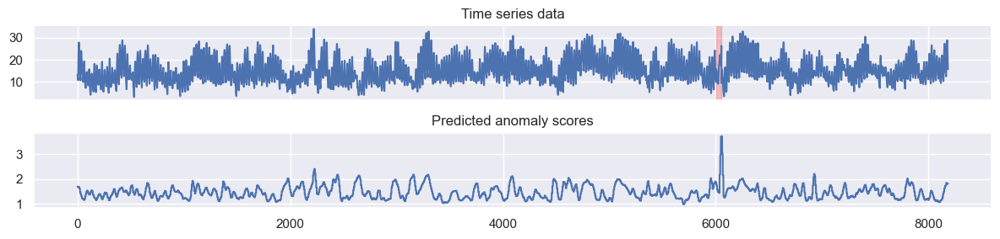

# HydraAD:  Exceptionally fast and accurate time series anomaly detection using competing random kernels

HydraAD is a highly effective and efficient anomaly detection model. It builds upon [Hydra](https://doi.org/10.1007/s10618-023-00939-3) for time series classification by leveraging groups of random convolutional kernels, from which features are generated. This repository  

## Installation

This project was developed using Python 3.11.8, but it should also work with other versions, as long as the dependencies can be installed. To install HydraAD, run the following command:
```bash 
pip install git+https://github.com/ML-KULeuven/HydraAD
```
Alternatively, you can also clone the code and run and run the following command in the directory:
```bash
pip install .
```

## Usage

HydraAD is build upon [dtaianomaly](https://github.com/ML-KULeuven/dtaianomaly), a Python tool for time series anomaly detection. The input of HydraAD is numpy array of shape ``(n_samples, n_channels)`` or ``(n_samples,)`` for univariate time series:
```python
from hydraad import TSBADLoader

dataset = TSBADLoader("/data/TSB-AD-U/463_UCR_id_161_Environment_tr_2046_1st_6006.csv").load()
X_train = dataset.X_train
X_test = dataset.X_test
y_test = dataset.y_test

X_train.shape, X_test.shape
>>> ((2046,), (8184,))
```

Then, anomalies can be detected with only a few lines of code:
```python
from hydraad import HydraAD
hydra_ad = HydraAD(window_size='fft')
hydra_ad.fit(X_train)
y_pred = hydra_ad.decision_function(X_test)
```


## Data and experimental results

The scripts for reproducing our experiments are available in the [scripts](scripts) folder and the raw experimental results are available in the [results](results) folder. We evaluated these results in Jupyter notebooks, which are available in the [notebooks](notebooks) folder. All evaluations were done using the TSB-AD dataset, a publicly available benchmark for time series anomaly detection.

## Acknowledgements

IF you find HydraAD useful for your research or applications, please consider citing our paper:
```bibtex
@inproceedings{carpentier2026hydraad,`
  title={{HydraAD: Exceptionally fast and accurate time series anomaly detection using competing random kernels}},
  author={Carpentier, Louis and Devos, Laurens and Weert, Wannes and Verbeke, Mathias},
  booktitle={Data Mining and Knowledge Discovery},
  year={2026}
}
```

## Contact

If you want to contribute, report bugs, or need help applying HydraAD for your application, feel free to reach out by opening a GitHub issue or contacting us via email at [louis.carpentier@kuleuven.be](mailto:louis.carpentier@kuleuven.be).

## License

    Copyright (c) 2026 KU Leuven, DTAI Research Group

    Permission is hereby granted, free of charge, to any person obtaining a copy
    of this software and associated documentation files (the "Software"), to deal
    in the Software without restriction, including without limitation the rights
    to use, copy, modify, merge, publish, distribute, sublicense, and/or sell
    copies of the Software, and to permit persons to whom the Software is
    furnished to do so, subject to the following conditions:

    The above copyright notice and this permission notice shall be included in all
    copies or substantial portions of the Software.

    THE SOFTWARE IS PROVIDED "AS IS", WITHOUT WARRANTY OF ANY KIND, EXPRESS OR
    IMPLIED, INCLUDING BUT NOT LIMITED TO THE WARRANTIES OF MERCHANTABILITY,
    FITNESS FOR A PARTICULAR PURPOSE AND NONINFRINGEMENT. IN NO EVENT SHALL THE
    AUTHORS OR COPYRIGHT HOLDERS BE LIABLE FOR ANY CLAIM, DAMAGES OR OTHER
    LIABILITY, WHETHER IN AN ACTION OF CONTRACT, TORT OR OTHERWISE, ARISING FROM,
    OUT OF OR IN CONNECTION WITH THE SOFTWARE OR THE USE OR OTHER DEALINGS IN THESOFTWARE.
